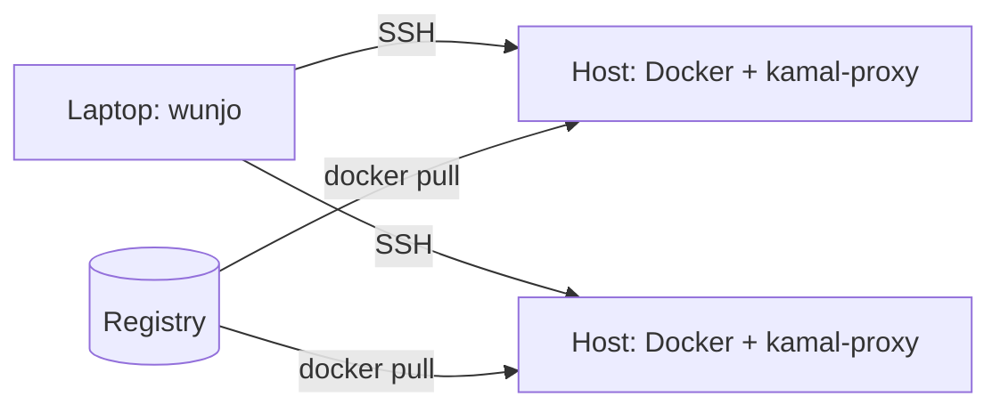

# Helvilette Wunjo

Helvilette Wunjo (_Wunjo_) is a command-line tool, written in Go, that deploys
containers from your laptop to your own servers over Secure Shell (SSH). You would use
it when Kamal fits your deployments except for its rules about hostnames, registries,
image tags, and Compose files. Wunjo starts as a port of Kamal 2.12.0, so you deploy
with the same `config/deploy.yml` and the same commands. To see a deploy, a redeploy,
and a rollback on your own machine, follow
[Deploy a sample app with Wunjo](docs/tutorials/deploy-a-sample-app.md).

> [!NOTE]
> Version 0.1.0 is the port of Kamal 2.12.0. The extensions that lift Kamal's rules
> come in later versions, which the [roadmap](ROADMAP.md) lists.

## What Wunjo is

Wunjo serves the _operator_: the person who deploys software to production and gets the
call when it breaks. In a small team, one operator often carries the whole
infrastructure. Developers in the same team run the same deploy command as a
convenience.

Wunjo builds on _Kamal_, an open-source deployment tool by 37signals under the MIT
license. Kamal pulls an image on each server over SSH. It then swaps the old container
for the new one after a health check, through its reverse proxy `kamal-proxy`. Kamal's
command-line interface is a Ruby program. Wunjo ports that interface to a single Go
binary and runs the same `kamal-proxy` binary unchanged.

_Helvilette_ is the umbrella name that the author, Aleksandr Slokov, gives to a set of
ideas about infrastructure software. The name Wunjo comes from ᚹ, the rune of joy.
Wunjo applies [The letter from Naught](docs/explanation/the-letter-from-naught.md), a
short manifesto for tools that serve a lone operator.

## Why you need Wunjo

With Kamal, one command deploys a release and one command rolls it back.
The `kamal-proxy` proxy switches traffic to the new container only after it passes its
health check, so a release does not drop requests. Kamal also encodes the setup of
37signals as rules: each service is a Ruby on Rails web app with a public hostname, the
image tag is the Git commit, and the registry uses HTTPS.

If your servers differ from that setup, you meet those rules in the following cases:

- Two services on one host that clients reach by IP address have no hostname, and
  `kamal-proxy` routes by hostname.
- Kamal's builder fails to push to an internal registry, such as Harbor, that uses
  plain HTTP or a certificate from an internal certificate authority (CA).
- You write the Compose file of each application again as `config/deploy.yml`, and the
  two files drift apart.
- Graphics processing unit (GPU) access, Loki logging, and network storage (NAS)
  volumes go through generic `options` fields.
- A successful deploy prints every remote command that it runs.

Wunjo keeps the deployment that Kamal provides and lifts these rules. The full reasoning
is in
[RFC 0001: Why Helvilette Wunjo exists](docs/explanation/rfc-0001-why-helvilette-wunjo.md).

## What Wunjo provides

Version 0.1.0 matches Kamal 2.12.0 command for command:

- `wunjo deploy`, `wunjo rollback`, and the other Kamal commands, with the same flags.
- The same `config/deploy.yml` and `.kamal/secrets` files.
- The subset of Embedded Ruby (ERB) templates that
  [ERB in deploy.yml](docs/explanation/rfc-0001-why-helvilette-wunjo.md#erb-in-deployyml)
  defines.
- The same Docker commands on the servers, matched to the character by Kamal's ported
  tests.
- One static binary for Linux and macOS, on amd64 and arm64, of about 9 MB.

Version 0.1.0 fetches secrets with three of Kamal's nine vault adapters: AWS Secrets
Manager (`aws_secrets_manager`), GCP Secret Manager (`gcp`), and Doppler (`doppler`).
The other six, 1Password, Bitwarden, Bitwarden Secrets Manager, LastPass, Enpass, and
Passbolt, stop with `Unknown secrets adapter`. To ask for one of them, open an issue
that names the adapter in the
[issue tracker](https://github.com/AlexanderSlokov/helvilette-wunjo/issues).

Kamal's integration suite passes with the `wunjo` binary: 17 tests that deploy seven
sample apps to Docker hosts in containers, in 454 seconds at commit `2dfa0f6`, as
[the session record](docs/references/sessions/2026-11-11-integration-suite.md) shows.

### Known differences from Kamal

Version 0.1.0 differs from Kamal 2.12.0 in the following ways that you can notice:

- Wunjo accepts only the ERB subset. An expression outside it, such as
  `` <%= `git rev-parse HEAD` %> ``, stops Wunjo before it contacts a server, with an
  error that names the file, the line, and the expression.
- Your OpenSSH client reads `~/.ssh/config` and the system file. Kamal also reads
  `./.ssh/config` in the working directory. To use another file, name it in
  `ssh/config` in `config/deploy.yml`.
- `wunjo version` prints the Wunjo version, 0.1.0. OpenTelemetry (OTel) logs keep
  `service.name` as `kamal`, so existing collector queries still match.

The full list is in
[Known differences from Kamal](docs/plans/port-kamal-to-go.md#known-differences-from-kamal).

## How Wunjo works

Wunjo runs on your laptop and has no component of its own on the servers. For each
deploy, Wunjo does the following, as Kamal does:

1. Reads the deploy file, and the secrets from `.kamal/secrets`.
1. Opens SSH connections to each host with your OpenSSH client, which reads
    `~/.ssh/config` and uses your SSH agent.
1. Runs Docker commands on each host: pull the image, start the new container, wait
    for its health check, and switch `kamal-proxy` to it.
1. Stops the old container and keeps it for rollback.



Figure 1. Wunjo drives Docker on each host over SSH, and each host pulls the image from
the registry.

Between deploys, Wunjo holds no running state. The state lives in Docker on each host,
where `docker ps` shows it.

## Before you begin

To run the example, you need `wunjo` and Git.
[Install Wunjo](docs/how-to/install-wunjo.md) describes how to install `wunjo`.
To deploy, you also need the OpenSSH client, `ssh`, and Docker with the Buildx plugin.

To work on the port, you need Go 1.27.3 or later and a checkout of Kamal at commit
`e3ec7b6`, as
[Port Kamal 2.12.0 to Go](docs/plans/port-kamal-to-go.md#before-you-begin) describes.

## Example

The `wunjo config` command reads `config/deploy.yml` and `.kamal/secrets` as
`wunjo deploy` does, and prints the configuration that a deploy would use. It contacts
no server, so you can run it on any machine. To check a deploy file, do the following:

1. Create a directory named `hello-app` with a Git repository in it. Wunjo tags each
    image with the Git commit, as Kamal does.

    ```shell
    mkdir -p hello-app/config hello-app/.kamal
    cd hello-app
    git init -q
    ```

1. Create the file `config/deploy.yml`:

    ```yaml
    service: hello
    image: example/hello
    servers:
      web:
        - app-01.example.com
        - app-02.example.com
    proxy:
      host: hello.example.com
      app_port: 8080
    registry:
      server: registry.example.com
      username: <%= ENV["REGISTRY_USER"] %>
      password:
        - REGISTRY_PASSWORD
    builder:
      arch: amd64
    ```

    The `username` line reads an environment variable through the ERB subset.

1. Create the file `.kamal/secrets`, which reads the registry password from your
    environment, and commit both files:

    ```shell
    echo 'REGISTRY_PASSWORD=$REGISTRY_TOKEN' > .kamal/secrets
    git add -A
    git commit -qm "Add the deploy file"
    ```

1. Print the configuration:

    ```shell
    REGISTRY_USER=deploy wunjo config
    ```

    The output is similar to this:

    ```console
    ---
    :roles:
    - web
    :hosts:
    - app-01.example.com
    - app-02.example.com
    :primary_host: app-01.example.com
    :version: 51004d7b70019b3387198a4672dbe88c0a5cfe5c
    :repository: registry.example.com/example/hello
    :absolute_image: registry.example.com/example/hello:51004d7b70019b3387198a4672dbe88c0a5cfe5c
    ...
    ```

The check worked when `:hosts:` lists both servers and `:version:` is your commit. If you
run `wunjo config` without `REGISTRY_USER`, Wunjo stops with Kamal's message:

```console
  ERROR (Kamal::ConfigurationError): registry/username: is required
```

To deploy an app to servers, follow
[Deploy a sample app with Wunjo](docs/tutorials/deploy-a-sample-app.md).

## What Wunjo is not

Wunjo deploys containers and leaves other jobs to other tools. It has the following
limits by design:

- Wunjo does not run a control plane, a scheduler, or an orchestrator.
- Wunjo does not reimplement Docker or Compose.
- Wunjo does not provision or configure servers. Tools such as Terraform or Ansible do
  that.
- Wunjo does not replace Kubernetes for workloads that need Kubernetes.
- Wunjo installs no agent and no web dashboard on the servers.
- Wunjo needs no runtime besides its own binary and the OpenSSH client.

## Project documents

The following documents describe the project:

| Document | Contents |
|---|---|
| [Deploy a sample app with Wunjo](docs/tutorials/deploy-a-sample-app.md) | A tutorial: deploy, redeploy, and roll back an app on a test stack. |
| [Install Wunjo](docs/how-to/install-wunjo.md) | Install `wunjo` from a release binary or from source. |
| [RFC 0001](docs/explanation/rfc-0001-why-helvilette-wunjo.md) | Why Wunjo exists and what it proposes. Open for comments. |
| [The letter from Naught](docs/explanation/the-letter-from-naught.md) | The principles that Wunjo applies. |
| [Port Kamal 2.12.0 to Go](docs/plans/port-kamal-to-go.md) | The stages of the port. |
| [Roadmap](ROADMAP.md) | The phases and their target versions. |
| [Backlog](BACKLOG.md) | The tasks of the current phase. |
| [Changelog](CHANGELOG.md) | The changes in each release. |

To comment on the design, open an issue or a pull request against RFC 0001.

## License

Wunjo is licensed under the [Apache License 2.0](LICENSE). Kamal is licensed under the
MIT license, copyright 2023 David Heinemeier Hansson. The [`NOTICE`](NOTICE) file keeps
Kamal's notice for the ported code.
