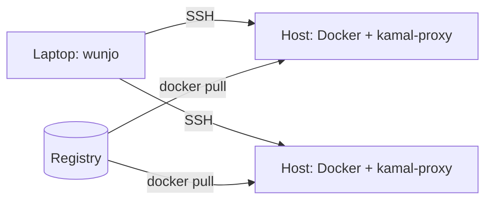

# Helvilette Wunjo

Helvilette Wunjo (_Wunjo_) is a command-line tool, written in Go, that deploys
containers from your laptop to your own servers over Secure Shell (SSH). You would use
it when Kamal fits your deployments except for its rules about hostnames, registries,
image tags, and Compose files. Wunjo starts as a port of Kamal 2.12.0, so you deploy
with the same `config/deploy.yml` and the same commands. You can check the proposed
file format today with `docker compose config`, as the [Example](#example) shows.

> [!NOTE]
> Wunjo is in its proposal phase. As of 2026-11-11, the repository holds the design and
> the plan. No code exists. The [roadmap](ROADMAP.md) lists the order of work.

## What Wunjo is

Wunjo serves the _operator_: the person who deploys software to production and gets the
call when it breaks. In a small team, one operator often carries the whole
infrastructure. Developers in the same team run the same deploy command as a
convenience.

Wunjo builds on _Kamal_, an open-source deployment tool by 37signals under the MIT
license. Kamal pulls an image on each server over SSH. It then swaps the old container
for the new one after a health check, through its reverse proxy `kamal-proxy`. Kamal's
command-line interface is a Ruby program. Wunjo ports that interface to a single Go
binary and runs the same `kamal-proxy` binary unchanged.

_Helvilette_ is the umbrella name that the author, Aleksandr Slokov, gives to a set of
ideas about infrastructure software. The name Wunjo comes from ᚹ, the rune of joy.
Wunjo applies [The letter from Naught](docs/explanation/the-letter-from-naught.md), a
short manifesto for tools that serve a lone operator.

## Why you need Wunjo

With Kamal, one command deploys a release and one command rolls it back.
The `kamal-proxy` proxy switches traffic to the new container only after it passes its
health check, so a release does not drop requests. Kamal also encodes the setup of
37signals as rules: each service is a Ruby on Rails web app with a public hostname, the
image tag is the Git commit, and the registry uses HTTPS.

If your servers differ from that setup, you meet those rules in the following cases:

- Two services on one host that clients reach by IP address have no hostname, and
  `kamal-proxy` routes by hostname.
- Kamal's builder fails to push to an internal registry, such as Harbor, that uses
  plain HTTP or a certificate from an internal certificate authority (CA).
- You write the Compose file of each application again as `config/deploy.yml`, and the
  two files drift apart.
- Graphics processing unit (GPU) access, Loki logging, and network storage (NAS)
  volumes go through generic `options` fields.
- A successful deploy prints every remote command that it runs.

Wunjo keeps the deployment that Kamal provides and lifts these rules. The full reasoning
is in
[RFC 0001: Why Helvilette Wunjo exists](docs/explanation/rfc-0001-why-helvilette-wunjo.md).

## What Wunjo provides

Version 0.1.0, the first planned release, matches Kamal 2.12.0 command for command:

- `wunjo deploy`, `wunjo rollback`, and the other Kamal commands, with the same flags.
- The same `config/deploy.yml` and `.kamal/secrets` files.
- The subset of Embedded Ruby (ERB) templates that
  [ERB in deploy.yml](docs/explanation/rfc-0001-why-helvilette-wunjo.md#erb-in-deployyml)
  defines.
- The same Docker commands on the servers, matched to the character by Kamal's ported
  tests.

The extensions that lift Kamal's rules come after the port. The [roadmap](ROADMAP.md)
lists them with their target versions.

## How Wunjo works

Wunjo runs on your laptop and has no component of its own on the servers. For each
deploy, Wunjo does the following, as Kamal does:

1. Reads the deploy file, and the secrets from `.kamal/secrets`.
1. Opens SSH connections to each host, with your `~/.ssh/config` and SSH agent.
1. Runs Docker commands on each host: pull the image, start the new container, wait
    for its health check, and switch `kamal-proxy` to it.
1. Stops the old container and keeps it for rollback.



Figure 1. Wunjo drives Docker on each host over SSH, and each host pulls the image from
the registry.

Between deploys, Wunjo holds no running state. The state lives in Docker on each host,
where `docker ps` shows it.

## Before you begin

To run the example, you need Docker with the Compose plugin. To work on the port, you
also need Go 1.27.3 or later and a checkout of Kamal at commit `e3ec7b6`, as
[Port Kamal 2.12.0 to Go](docs/plans/port-kamal-to-go.md#before-you-begin) describes.

## Example

RFC 0001 proposes a Compose file as the deploy file. Docker Compose ignores keys that
start with `x-`, so Wunjo's settings go under `x-wunjo` and the file stays valid for
`docker compose`. To check that Docker Compose accepts such a file, do the following:

1. Create a directory named `wunjo-example` and a file `compose.yaml` in it:

    ```yaml
    services:
      comfyui:
        image: harbor.lan:8080/ai/comfyui:latest
        gpus: all
        volumes:
          - models:/opt/models
        x-wunjo:
          hosts: [gpu-node-01]
          health: /system_stats

    volumes:
      models:
        driver_opts:
          type: nfs
          o: addr=nas-01.lan,rw
          device: ":/export/models"
    ```

    The `x-wunjo` block names the hosts that run the service and the path of its health
    check. GPU access and the NAS volume stay in Compose's own syntax.

1. In the `wunjo-example` directory, validate the file:

    ```shell
    docker compose config
    ```

    The output is similar to this:

    ```console
    name: wunjo-example
    services:
      comfyui:
        gpus:
          - count: -1
        image: harbor.lan:8080/ai/comfyui:latest
        networks:
          default: null
        volumes:
          - type: volume
            source: models
            target: /opt/models
            volume: {}
        x-wunjo:
          health: /system_stats
          hosts:
            - gpu-node-01
    networks:
      default:
        name: wunjo-example_default
    volumes:
      models:
        name: wunjo-example_models
        driver_opts:
          device: :/export/models
          o: addr=nas-01.lan,rw
          type: nfs
    ```

The check worked when the output contains the `x-wunjo` block. If you stop using Wunjo,
`docker compose up` still runs the same file. The output above comes from Docker 29.9.2
and Docker Compose 5.7.0.

## What Wunjo is not

Wunjo deploys containers and leaves other jobs to other tools. It has the following
limits by design:

- Wunjo does not run a control plane, a scheduler, or an orchestrator.
- Wunjo does not reimplement Docker or Compose.
- Wunjo does not provision or configure servers. Tools such as Terraform or Ansible do
  that.
- Wunjo does not replace Kubernetes for workloads that need Kubernetes.
- Wunjo installs no agent and no web dashboard on the servers.
- Wunjo needs no runtime besides its own binary.

## Project documents

The following documents describe the project:

| Document | Contents |
|---|---|
| [RFC 0001](docs/explanation/rfc-0001-why-helvilette-wunjo.md) | Why Wunjo exists and what it proposes. Open for comments. |
| [The letter from Naught](docs/explanation/the-letter-from-naught.md) | The principles that Wunjo applies. |
| [Port Kamal 2.12.0 to Go](docs/plans/port-kamal-to-go.md) | The stages of the port. |
| [Roadmap](ROADMAP.md) | The phases and their target versions. |
| [Backlog](BACKLOG.md) | The tasks of the current phase. |

To comment on the design, open an issue or a pull request against RFC 0001.

## License

Wunjo is licensed under the [Apache License 2.0](LICENSE). Kamal is licensed under the
MIT license, copyright 2023 David Heinemeier Hansson. Backlog task WJ-002 adds a
`NOTICE` file that keeps Kamal's notice for the ported code.
