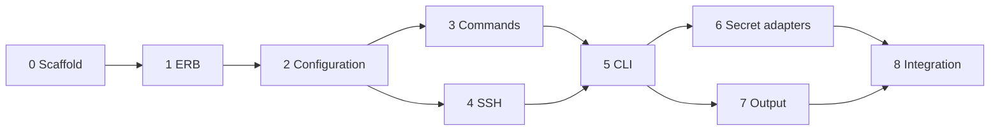

# Port Kamal 2.12.0 to Go

This plan ports Kamal 2.12.0 from Ruby to Go as the first phase of Helvilette Wunjo.
[RFC 0001](../explanation/rfc-0001-why-helvilette-wunjo.md#implementation-strategy)
records why the port comes first and which rules it follows. The port is complete when
the Go binary `wunjo` passes the ported Kamal test suite and deploys one of the author's
real services from its existing `config/deploy.yml`. The Wunjo extensions are out of
scope here and get their own plan.

## Source

The following table identifies the upstream code that this plan ports:

| Field | Value |
|---|---|
| Repository | <https://github.com/basecamp/kamal> |
| Version | 2.12.0 |
| Commit | `e3ec7b6`, 2026-10-21 |
| License | MIT, copyright 2023 David Heinemeier Hansson |
| Ruby in `lib/` | 8,623 lines in 109 files |
| Ruby in `test/` | 11,945 lines, plus 45 fixture files |

The line counts come from `find lib -name '*.rb' | xargs cat | wc -l` and the same
command on `test/`, run on 2026-11-10 at commit `e3ec7b6`.

## Rules for every stage

Each stage follows these rules:

1. **Port the tests first.** Translate the Ruby tests of the stage into Go tests before
    writing the code. Keep the test names, so a Go test maps back to its Ruby test.
1. **Match the output to the character.** A command test expects the same Docker
    command string as the Ruby test. A difference is a bug in the port.
1. **Name the source.** Each Go file starts with a comment that names the Ruby file it
    ports, for example `// Ports lib/kamal/commands/app.rb at Kamal 2.12.0.`
1. **Keep the ported code free of extensions.** Wunjo features go in `internal/wunjo/`
    in a later phase. The ported code in `internal/kamal/` stays a faithful port.
1. **Wrap third-party libraries.** The command-line framework, the YAML parser, and the
    SSH client each sit behind a small interface owned by this project, as `AGENTS.md`
    requires.

## Pitfalls that affect string parity

Four differences between Ruby and Go change command strings unless the port handles
them:

- **Key order.** Ruby hashes keep insertion order, and Kamal emits `--env` and
    `--label` flags in that order. Go maps do not keep order. The port reads YAML into
    ordered structures, such as `yaml.Node`, and keeps the order through to the command.
- **YAML version.** Ruby's Psych parser follows YAML 1.1, where `yes` and `on` are
    booleans. Go's `gopkg.in/yaml.v3` follows YAML 1.2. The configuration loader
    applies the YAML 1.1 rules wherever Kamal's behavior depends on them.
- **Shell escaping.** Kamal quotes arguments with Ruby's `shellescape` and its own
    `Kamal::Utils` helpers. The port reproduces their exact output, which the stage 3
    tests check.
- **ERB.** Wunjo renders only the subset defined in
    [ERB in deploy.yml](../explanation/rfc-0001-why-helvilette-wunjo.md#erb-in-deployyml).
    Some Kamal fixtures call `ArchHelper.remote_arch`. The Go tests replace those calls
    with an environment variable and record each replacement in the test file.

## Stages

### Stage 0: Scaffold

Create the Go module, the `wunjo` entry point, and the test command.

- Files: `go.mod`, `cmd/wunjo/main.go`, `Makefile`, `NOTICE`,
    `internal/kamal/testdata/fixtures/` (copied from `test/fixtures/` under the MIT
    notice), and the configuration documents from `lib/kamal/configuration/docs/`
    (embedded with `go:embed`, because Kamal's validator compares keys against them).
- Done when: `make test` runs `go test ./...` and passes, `go vet ./...` reports
    nothing, and `NOTICE` carries Kamal's MIT copyright and permission notice.

### Stage 1: ERB subset

Port the rendering step of `lib/kamal/configuration.rb` (line 42) and of
`lib/kamal/configuration/accessory.rb` (line 169) as a renderer for the ERB subset.

- Files: `internal/kamal/erb/`.
- Depends on: stage 0.
- Done when: each form in the RFC's ERB table has a passing test, each unsupported form
    returns the error with file, line, and expression, and all 45 fixtures render after
    the documented `ArchHelper` replacements.

### Stage 2: Configuration and secret files

Port `lib/kamal/configuration.rb`, `lib/kamal/configuration/` (2,027 lines), the
validators, `env_file.rb`, `tags.rb`, `git.rb`, `utils.rb`, `utils/sensitive.rb`,
`secrets.rb`, and `secrets/dotenv/inline_command_substitution.rb`. The secret file
loader belongs here because configuration reads secrets for `env.secret`.

- Files: `internal/kamal/configuration/`, `internal/kamal/secrets/`,
    `internal/kamal/envfile/`, `internal/kamal/utils/`.
- Tests ported: `test/configuration_test.rb`, `test/configuration/`, `test/env_file_test.rb`,
    `test/git_test.rb`, `test/utils_test.rb`, `test/secrets_test.rb`,
    `test/secrets/dotenv_inline_command_substitution_test.rb`.
- Depends on: stage 1.
- Done when: every ported test passes, including the validation error messages.

### Stage 3: Command builders

Port `lib/kamal/commands/` (1,463 lines) and `lib/kamal/commands.rb`, including the
builder commands for the local, remote, hybrid, cloud, and pack drivers.

- Files: `internal/kamal/commands/`.
- Tests ported: `test/commands/` (215 tests).
- Depends on: stage 2.
- Done when: all 215 tests pass with the same Docker command strings as Kamal.

### Stage 4: SSH execution

Replace SSHKit, `sshkit_with_ext.rb`, and `commander.rb` with a Go runner. The runner
executes commands on many hosts in parallel, reads `~/.ssh/config`, supports
ProxyJump, proxy commands, and the SSH agent, and retries DNS failures as Kamal does.

- Files: `internal/kamal/sshexec/`, `internal/kamal/commander/`.
- Tests ported: `test/commander_test.rb`, `test/configuration/ssh_test.rb`,
    `test/configuration/sshkit_test.rb`, `test/sshkit_dns_retry_test.rb`.
- Depends on: stage 2.
- Done when: the ported tests pass against a named fake runner, and one command runs
    on a real host through the SSH agent.

### Stage 5: Command-line interface

Port `lib/kamal/cli/` (2,559 lines): `deploy`, `redeploy`, `rollback`, `app`,
`accessory`, `proxy`, `build`, `registry`, `server`, `lock`, `prune`, `secrets`,
aliases, hooks, and the health-check poller.

- Files: `internal/kamal/cli/`, `cmd/wunjo/`.
- Tests ported: `test/cli/` (about 3,300 lines). The Ruby tests stub SSHKit and check
    the commands it receives. The Go tests use the fake runner from stage 4.
- Depends on: stages 3 and 4.
- Done when: every ported CLI test passes, and `wunjo --help` lists the same commands
    as `kamal --help` at version 2.12.0.

### Stage 6: Secret adapters

Port the ten adapters in `lib/kamal/secrets/adapters/`: AWS Secrets Manager, Bitwarden,
Bitwarden Secrets Manager, Doppler, Enpass, GCP Secret Manager, LastPass, 1Password,
Passbolt, and the test adapter. Each adapter calls the vendor's command-line tool.

- Files: `internal/kamal/secrets/adapters/`.
- Tests ported: `test/secrets/` (about 2,200 lines), with a named fake for the vendor
    tools.
- Depends on: stage 5.
- Done when: every ported adapter test passes.

### Stage 7: Output and OpenTelemetry

Port `lib/kamal/output/` and `lib/kamal/otel_shipper.rb`, which write deploy logs to a
file and ship them to an OpenTelemetry (OTel) collector that the operator configures.

- Files: `internal/kamal/output/`.
- Tests ported: `test/output/`, `test/otel_shipper_test.rb`,
    `test/configuration/output_test.rb`.
- Depends on: stage 5.
- Done when: every ported test passes.

### Stage 8: Integration and acceptance

Port Kamal's integration suite in `test/integration/`. It starts Docker hosts, a
registry, and an OTel collector with Docker Compose, then deploys through the CLI.

- Files: `test/integration/`.
- Depends on: stages 5, 6, and 7.
- Done when: the ported integration tests pass with the `wunjo` binary, and the author
    deploys one real service with `wunjo deploy` from its existing `config/deploy.yml`
    without editing the file.

## Order of work

Stages 1, 2, and 3 run in sequence. Stage 4 can run in parallel with stage 3. Stages 6
and 7 can run in parallel after stage 5.



Figure 1. Stage dependencies of the Kamal port.

## Decisions

The author settled the following choices on 2026-11-11:

| Choice | Decision |
|---|---|
| Command-line library | `spf13/cobra`, the standard in the Go ecosystem, behind an interface owned by this project. |
| Go version | Go 1.27, the latest stable release. `go.mod` sets `go 1.27`, and the toolchain is 1.27.3 or later. |
| Release | The finished port ships as version 0.1.0. |

## Before you begin

The work needs the following tools:

- Go 1.27.3 or later. Check the version with `go version`.
- Docker with the `buildx` plugin, for the stage 3 builder tests and the stage 8
    integration tests.
- A checkout of Kamal at commit `e3ec7b6`, to read the Ruby source and tests:

    ```shell
    git clone https://github.com/basecamp/kamal.git
    git -C kamal checkout e3ec7b6
    ```
